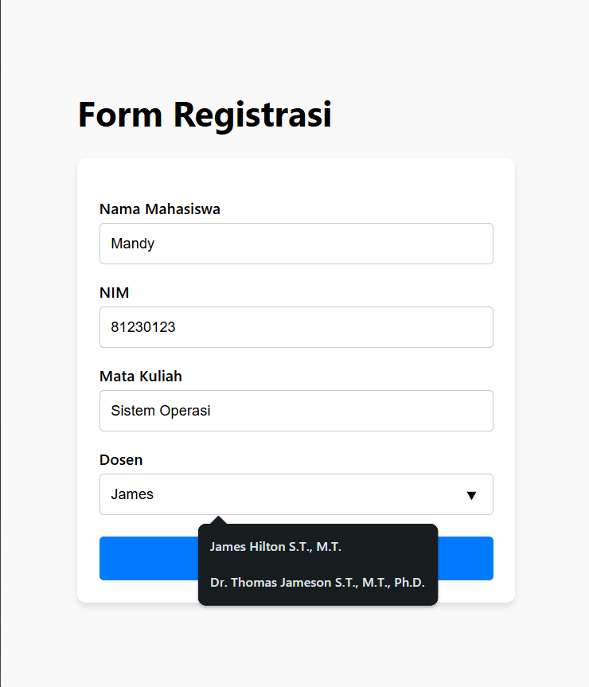
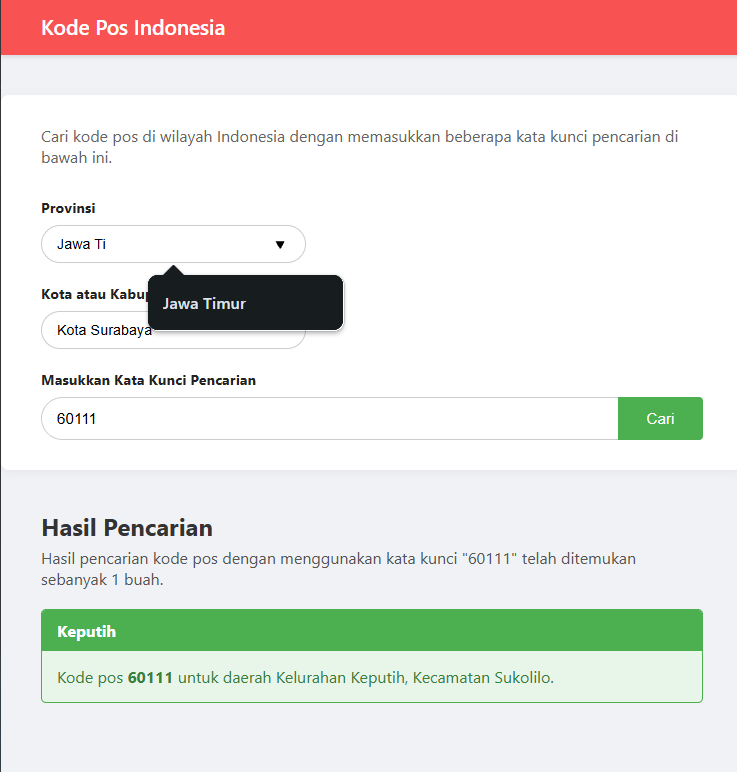
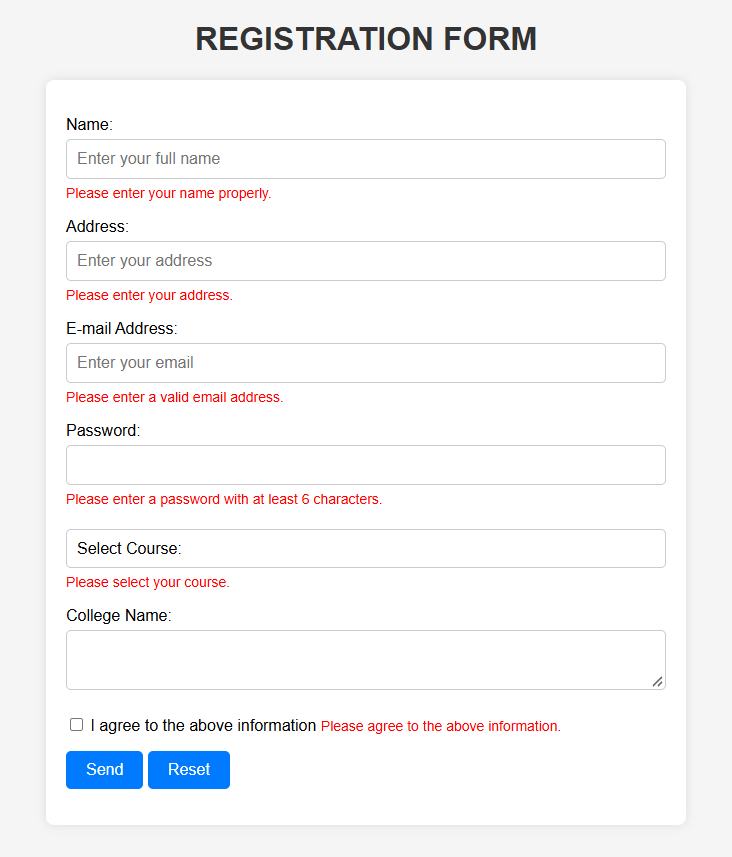
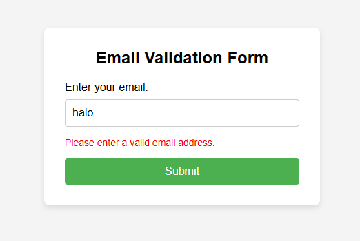
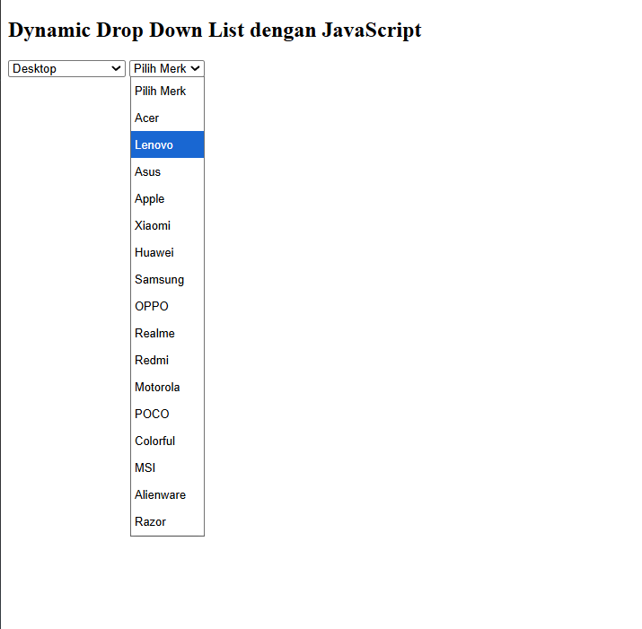

# Latihan Javascript

### Identitas
Nama : Benedictus Imanuel Wicaksono 
NRP  : 5025251039

## Latihan 1

**Buatlah sebuah form registrasi yang terdiri dari nama mahasiswa, nim, mata kuliah, dan dosen. Form registrasi ini memiliki aturan sebagai berikut. Ketika pengguna sistem akan mengisikan data nama dengan memasukkan huruf tertentu maka akan muncul rekomendasi tertentu. Gunakan referensi di internet ataupun yang lainnya untuk memecahkan kasus tersebut.**

### Penyelesaian

  

**Fitur:**
*   **Autocomplete/Rekomendasi Otomatis:** Sistem memberikan rekomendasi nama mahasiswa dan nama dosen secara langsung saat pengguna mulai mengetikkan karakter pada kolom input.

**Langkah-langkah:**
1.  Membuat struktur form registrasi dasar pada file HTML (`index.html`) yang terdiri dari input nama, NIM, mata kuliah, dan dosen.
2.  Menambahkan elemen `<datalist>` dengan `id` khusus tepat di bawah input nama dan input dosen. Elemen input kemudian dihubungkan dengan *datalist* tersebut menggunakan atribut `list`.
3.  Membuat file JavaScript (`tugas1.js`) yang berisi *array* data (contoh: `databaseMahasiswa` dan `databaseDosen`).
4.  Menggunakan JavaScript untuk memanipulasi DOM dengan menyuntikkan data dari *array* ke dalam elemen `<datalist>`.

**Cara Kerja:**
JavaScript mengambil elemen `<datalist>` berdasarkan ID menggunakan `document.getElementById()`. Setelah itu, fungsi `map()` digunakan untuk melakukan iterasi pada *array* data (seperti `databaseMahasiswa`). Setiap nama di dalam *array* diubah formatnya menjadi *string* HTML berupa elemen `<option value="Nama">`. Kumpulan *string* ini kemudian digabungkan dengan fungsi `join('')` dan disisipkan langsung ke dalam properti `innerHTML` milik `<datalist>`. Peramban (*browser*) secara otomatis akan membaca elemen `<option>` di dalam `<datalist>` tersebut sebagai rekomendasi yang muncul ketika pengguna mengetikkan huruf yang sesuai (pencocokan parsial).

---

## Latihan 2

**Buatlah pencarian kode pos Indonesia dengan inputan Provinsi, Kabupaten/ Kota, Kecamatan, kemudian outputnya kode pos dan informasi daerah.**

### Penyelesaian

  

**Fitur:**
*   **Smart Autofill & Text Selection:** Saat pengguna mengetik nama provinsi atau kota, sistem secara otomatis melengkapi (*autofill*) sisa kata dan memblok teks tersebut sehingga proses input menjadi lebih cepat.
*   **Pencarian Berbasis Kata Kunci:** Pengguna dapat mencari kode pos berdasarkan nama kecamatan, kelurahan, atau kode pos itu sendiri.
*   **Tampilan Hasil Dinamis:** Hasil pencarian ditampilkan dalam bentuk antarmuka *card* yang rapi, lengkap dengan jumlah data yang berhasil ditemukan.

**Langkah-langkah:**
1.  Menyiapkan sumber data eksternal berupa file `kodepos.csv` dan mendefinisikan *class* `KodePos` di JavaScript sebagai cetak biru (*blueprint*) objek penyimpan data.
2.  Membaca dan mem-parsing data CSV menggunakan `Fetch API` lalu menyimpannya ke dalam sebuah *array*.
3.  Menambahkan *event listener* tipe `input` pada kolom Provinsi dan Kota untuk mendeteksi ketikan pengguna dan mengaktifkan fitur *smart autofill*.
4.  Menambahkan *event listener* pada form (tipe `submit`) untuk memproses kata kunci pencarian, memfilter *array* berdasarkan kata kunci, lalu merender hasilnya ke layar menggunakan *Template Literals*.

**Cara Kerja:**
*   **Pengambilan Data:** `fetch('Database/kodepos.csv')` dipanggil untuk mengambil file teks. File ini kemudian dipecah berdasarkan baris (`\n`) dan kolom (`.split(',')`). Data spesifik (kecamatan, kelurahan, dan kode pos) diekstrak dan diinstansiasi menjadi objek dari *class* `KodePos`, lalu dimasukkan ke *array* `databaseKodePos`.
*   **Autofill Input:** Saat ada event `input`, JavaScript mengecek apakah teks yang diketik memiliki awalan yang cocok dengan nama provinsi/kota menggunakan fungsi `.find()` dan `.startsWith()`. Jika cocok, nilai kolom input akan diubah secara otomatis, dan fungsi `setSelectionRange()` digunakan untuk memblok (*highlight*) teks sisa dari prediksi kata tersebut.
*   **Pencarian:** Ketika form disubmit, fungsi `.filter()` akan menelusuri *array* `databaseKodePos`. Jika ada kata kunci yang cocok (`.includes()`) dengan kode pos, kelurahan, atau kecamatan (dalam huruf kecil/ *lowercase*), data tersebut akan disimpan, dibungkus menjadi susunan elemen HTML `
`, dan disuntikkan ke dalam layar menggunakan `innerHTML`.

---

## Latihan 3

**Buatlah form registrasi dengan validasi klien untuk memastikan kebenaran data yang dikirimkan.**

### Penyelesaian

 

**Fitur:**
*   **Validasi Real-Time Form Submit:** Mencegah pengiriman form jika ada data yang kosong atau tidak memenuhi syarat.
*   **Validasi Spesifik:** Memastikan nama tidak mengandung angka, email memiliki karakter wajib (`@` dan `.`), password minimal 6 karakter, serta persetujuan *checkbox* dicentang.
*   **Pesan Kesalahan Dinamis:** Menampilkan peringatan (*error message*) berwarna merah yang spesifik tepat di bawah input yang bermasalah.

**Langkah-langkah:**
1.  Merancang form registrasi di HTML dan menyisipkan elemen `` dengan *class* `error-message` kosong di bawah setiap kolom input.
2.  Menambahkan atribut `onsubmit="return validateForm()"` dan `onreset="resetErrors()"` pada tag `<form>`.
3.  Membuat logika validasi di file JavaScript yang melakukan pengecekan satu per satu berdasarkan nilai input (`.value`).

**Cara Kerja:**
Ketika pengguna menekan tombol *Send/Submit*, fungsi `validateForm()` dieksekusi. Fungsi ini mendeklarasikan variabel *flag* `isValid = true`. Selanjutnya, logika bersyarat (`if`) memeriksa setiap nilai. Misalnya, `/\d/.test(name)` digunakan untuk mengecek apakah variabel `name` mengandung angka (*digit*). Jika ada pelanggaran syarat, `isValid` diubah menjadi `false`, dan teks elemen `` diisi dengan pesan peringatan. Pada akhir fungsi, jika `isValid` bernilai `false`, fungsi akan melakukan `return false;` yang secara bawaan mencegah form HTML untuk memproses data.

---

### Latihan 3 - Tambahan (Validasi Email Khusus)

**Buatlah formulir dengan validasi email secara presisi menggunakan format yang baku.**

### Penyelesaian

 

**Fitur:**
*   **Validasi Struktur Email Kuat:** Menggunakan *Regular Expression* (Regex) untuk memastikan input benar-benar memiliki format struktur email yang valid (contoh: `nama@domain.com`).

**Langkah-langkah:**
1.  Membuat antarmuka input tunggal khusus untuk email.
2.  Menangkap *event* submit menggunakan `addEventListener("submit", ...)`.
3.  Mendefinisikan pola (pattern) Regex untuk email di dalam JavaScript.

**Cara Kerja:**
Fungsi menggunakan metode `e.preventDefault()` untuk mencegah halaman termuat ulang (*reload*) saat di-submit. Pola Regex `/^[a-zA-Z0-9._-]+@[a-zA-Z0-9.-]+\.[a-zA-Z]{2,4}$/` dideklarasikan. Pola ini memastikan bahwa string berawalan karakter alfanumerik (atau . _ -), diikuti dengan karakter wajib `@`, nama domain, karakter wajib `.`, dan ekstensi domain sepanjang 2-4 huruf (seperti `.com`, `.id`). String email kemudian dievaluasi menggunakan metode `pattern.test(email)`. Jika hasilnya `true`, pesan berhasil akan muncul, sebaliknya jika `false`, pesan *error* akan dimunculkan ke layar.

---

## Latihan 4

**Membuat List Dropdown dinamis.**

### Penyelesaian

**Fitur:**
*   **Dropdown Ter-generasi Otomatis:** Opsi di dalam *dropdown* tidak ditulis secara manual (*hardcoded*) di dalam file HTML, melainkan disuntikkan (*injected*) langsung oleh sistem JavaScript.

**Langkah-langkah:**
1.  Membuat elemen seleksi kosong `<select id="list-produk">` dan `<select id="list-merk">` di dalam HTML.
2.  Menyiapkan *array* sumber data di JavaScript, seperti `databaseProduk` dan `databaseMerk`.
3.  Menerapkan manipulasi DOM menggunakan JavaScript untuk menyuntikkan tag `<option>` ke dalam tag `<select>`.

**Cara Kerja:**
Metode ini bekerja menggunakan prinsip *Array Mapping*. JavaScript akan mengambil *array* `databaseProduk` dan menggunakan fungsi `.map()` untuk memanipulasi setiap isi elemen *array* menjadi format teks HTML (contoh: teks `"Desktop"` diubah menjadi string `<option value="Desktop">Desktop</option>`). Kumpulan string yang dikembalikan oleh `.map()` ini digabungkan menggunakan fungsi `.join('')` agar menjadi satu teks panjang yang utuh. Teks ini kemudian disisipkan (ditambahkan ke opsi "Pilih Produk/Merk" secara bawaan) ke dalam elemen `<select>` menggunakan properti `innerHTML`.